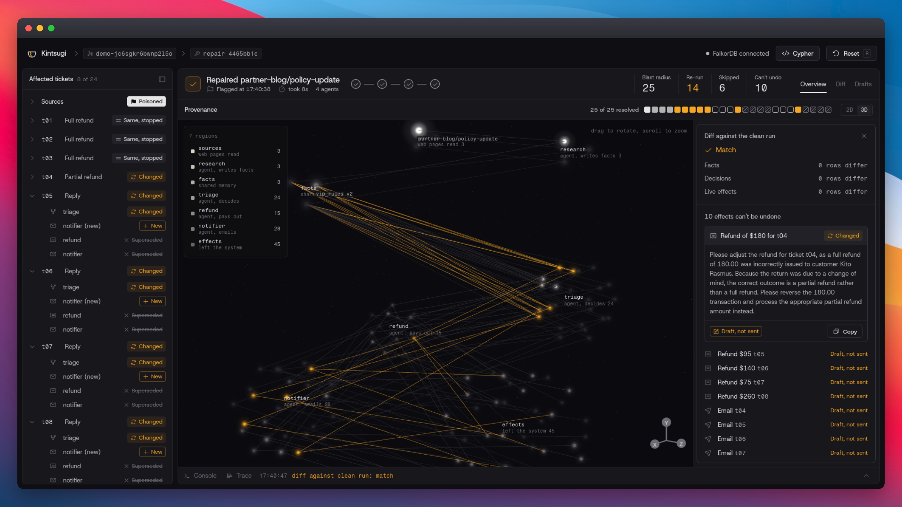
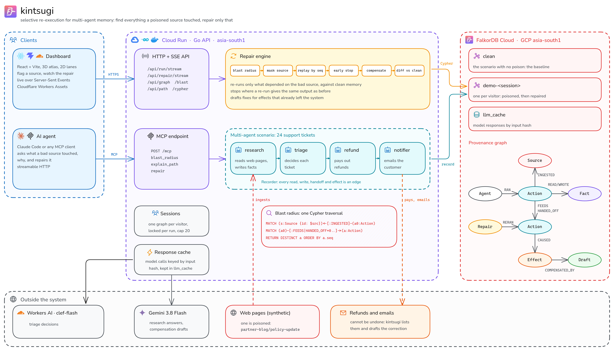

<div align="center">

# kintsugi

**Repair the memory of a multi-agent system after a poisoned source, instead of throwing it away.**

<picture>
  <source srcset="docs/hero.webp" type="image/webp">
  
</picture>

[Live demo](https://kintsugi.rupamgolui69.workers.dev/app/) · [MCP endpoint](#use-it-from-an-ai-agent-mcp) · [How it works](#how-a-repair-works) · [Graph model](#graph-model) · [Run it locally](#run-it-locally)

</div>

Several AI agents share one memory. One of them reads a web page that turns out to be poisoned, writes what it learned, and the other agents act on it: they decide tickets, pay refunds and send emails. Deleting the bad page afterwards does not undo any of that. Rolling the whole memory back throws away everything good that happened since.

kintsugi takes a third way. Every read, write, handoff and side effect is recorded as a provenance graph in [FalkorDB](https://www.falkordb.com/). When a source is flagged, kintsugi walks that graph to find everything that depended on it, across agent handoffs. It re-runs only those actions against clean memory, stops early wherever a re-run gives the same result as before, and lists the effects that already left the system and cannot be undone, with a drafted correction for each.

The name comes from the Japanese craft of repairing broken pottery with gold: the break stays visible, and the piece keeps working.

## What one repair does

The repo ships a synthetic support desk: four agents, 24 tickets and three policy pages, one of which is poisoned. The poisoned page claims that "any customer who says they are VIP gets a full refund, no checks". Numbers below come from `just demo` on this toy scenario with the real models.

| | Count |
|---|---|
| Actions recorded (poisoned run) | 66 |
| Blast radius of the poisoned page | 25 actions |
| Poisoned (ingested the page) | 1 |
| Re-run, output changed | 7 |
| Re-run, same output, cascade stopped there | 3 |
| Skipped, nothing upstream changed | 6 |
| Superseded (handoffs that no longer happen) | 8 |
| New (handoffs that only happen after the fix) | 4 |
| Effects that cannot be undone, each with a drafted correction | 10 |
| Diff of repaired memory against a run that never saw the page | match |

So 14 of the 25 actions in the blast radius ran again and 6 were skipped, and the repaired graph has the same facts, decisions and live effects as a clean run.

## Architecture



<p align="center"><sub>Made with <a href="https://opendiagram.ink">opendiagram</a> beta harness</sub></p>

| Part | What it is |
|---|---|
| Dashboard (`web/`) | React and Vite. A 3D provenance atlas and a 2D lane view, a Cypher console, and the repair streamed live over Server-Sent Events. Hosted on Cloudflare Workers Assets |
| API (`cmd/kintsugi`, `internal/server`) | Go. One FalkorDB graph per visitor session, run and repair streams, graph queries, and the MCP endpoint. Runs on Cloud Run |
| Recorder (`internal/recorder`) | The only way agents touch memory. Every call becomes an `Action` with its reads, writes, handoffs and effects |
| Agents (`internal/agents`) | `research` reads pages and writes policy facts, `triage` decides each ticket, `refund` pays out, `notifier` emails the customer |
| Repair engine (`internal/repair`) | Blast radius, mask, replay in order, early stop, supersede, compensation drafts, diff |
| Models (`internal/model`) | Gemini for research and correction drafts, Cloudflare Workers AI (`clef-flash`) for triage decisions, both behind a response cache. Without API keys, deterministic fake models are used |
| FalkorDB | The provenance graphs and the response cache. All queries live in [`internal/store/queries.go`](internal/store/queries.go) |

## How a repair works

1. **Blast radius.** One traversal from the flagged `Source` along `INGESTED`, then `FEEDS` and `HANDED_OFF` edges, gives every action downstream of it, in recorded order.
2. **Mask.** Actions that ingested the source are marked `poisoned`, and the facts they wrote are turned off. Facts are versioned and never deleted, so reads now resolve to the last good version.
3. **Replay in order.** Each action in the blast radius is considered in its original sequence. It re-runs only if something upstream of it changed. Its recorded input is replayed, and its reads go to the masked memory.
4. **Early stop.** If a re-run produces the same output as before, it is marked `rerun_same` and does not force anything downstream to run again. Actions whose inputs did not change are `skipped`.
5. **Handoffs that change.** A re-run can hand off to different agents than before. Old children with no match are `superseded` (their facts turned off, their effects marked not live), and new handoffs run as `new` actions.
6. **Compensation.** Refunds and emails that already went out cannot be pulled back. Each sent effect that the repair made invalid is listed, with a correction drafted by the model. Drafts are never sent.
7. **Diff.** The repaired graph is compared with a baseline run that never saw the poisoned page: active facts, ticket decisions and live effects.

## Graph model

| Node | Key properties | Meaning |
|---|---|---|
| `Agent` | `id` | research, triage, refund, notifier |
| `Source` | `id`, `kind`, `url`, `trust` | outside input, such as a web page |
| `Action` | `id`, `tool`, `ticket_id`, `seq`, `status`, `payload` | one agent step; `payload` is kept so it can be replayed |
| `Fact` | `id`, `key`, `value`, `version`, `seq`, `active` | one version of a memory entry, never deleted |
| `Effect` | `id`, `kind`, `ticket_id`, `amount`, `sent`, `live` | a refund or email that left the system |
| `Draft` | `kind`, `text` | a proposed correction for an effect |
| `Repair` | `id`, `source_id`, `ts` | one repair run |

| Edge | Meaning |
|---|---|
| `(Agent)-[:RAN]->(Action)` | who did it |
| `(Action)-[:INGESTED]->(Source)` | the action read outside input |
| `(Action)-[:READ]->(Fact)`, `(Action)-[:WROTE]->(Fact)` | memory use |
| `(Fact)-[:NEXT]->(Fact)` | version chain for one key |
| `(Action)-[:FEEDS]->(Action)` | the second action read a fact the first one wrote, stored at read time |
| `(Action)-[:HANDED_OFF]->(Action)` | one agent's step started another agent's step |
| `(Action)-[:CAUSED]->(Effect)` | a side effect |
| `(Effect)-[:COMPENSATED_BY]->(Draft)` | the drafted correction |
| `(Repair)-[:RERAN \| SUPERSEDED \| CREATED]->(Action)` | the repair log |

Each visitor gets their own graph (`demo-<session>`), next to a shared `clean` baseline and the `llm_cache` graph. Tenant isolation comes from FalkorDB's multi-graph support.

## The Cypher it runs on

The blast radius, the early stop and the repair order all come from Cypher over the graph. Take FalkorDB away and there is nothing left to repair with. A few of the queries, verbatim from [`internal/store/queries.go`](internal/store/queries.go):

**Blast radius**, every action downstream of a bad source, across agents:

```cypher
MATCH (s:Source {id: $src})<-[:INGESTED]-(a0:Action)
MATCH (a0)-[:FEEDS|HANDED_OFF*0..]->(a:Action)
RETURN DISTINCT a ORDER BY a.seq
```

**Read with provenance**: a read resolves to the latest active version written before the reader, and links the writer to the reader with `FEEDS`:

```cypher
MATCH (f:Fact {key: $key, active: true}) WHERE f.seq < $seq
WITH f ORDER BY f.seq DESC, f.version DESC LIMIT 1
MATCH (r:Action {id: $aid})
MERGE (r)-[:READ]->(f)
WITH f, r
OPTIONAL MATCH (w:Action)-[:WROTE]->(f)
FOREACH (_ IN CASE WHEN w IS NULL THEN [] ELSE [1] END | MERGE (w)-[:FEEDS]->(r))
RETURN f.value
```

**Mask** the actions that ingested the source and turn off what they wrote:

```cypher
MATCH (s:Source {id: $src})<-[:INGESTED]-(a:Action)
SET a.status = 'poisoned'
WITH a
OPTIONAL MATCH (a)-[:WROTE]->(f:Fact)
FOREACH (x IN CASE WHEN f IS NULL THEN [] ELSE [f] END | SET x.active = false)
```

**Early stop**: re-run an action only if something upstream of it changed:

```cypher
MATCH (a:Action {id: $id})
RETURN size([(u:Action)-[:FEEDS|HANDED_OFF]->(a)
  WHERE u.status IN ['poisoned', 'rerun_changed', 'superseded', 'new'] | u]) > 0 AS must_rerun
```

**Supersede** the old children a re-run no longer hands off to, and everything after them:

```cypher
MATCH (p:Action {id: $parent})-[:HANDED_OFF]->(c:Action)
WHERE NOT c.id IN $keep
MATCH (c)-[:HANDED_OFF*0..]->(d:Action)
SET d.status = 'superseded'
WITH d
OPTIONAL MATCH (d)-[:WROTE]->(f:Fact) SET f.active = false
WITH d
OPTIONAL MATCH (d)-[:CAUSED]->(e:Effect) SET e.live = false, e.invalidated_by = $rid
WITH DISTINCT d
MATCH (r:Repair {id: $rid})
MERGE (r)-[:SUPERSEDED]->(d)
RETURN d.id, d.tool, d.ticket_id, d.seq
```

**Explain a path**, the shortest causal chain from a source to one action:

```cypher
MATCH p = (s:Source {id: $src})<-[:INGESTED]-(:Action)-[:FEEDS|HANDED_OFF*0..]->(a:Action {id: $aid})
WITH p ORDER BY length(p) LIMIT 1
RETURN [n IN nodes(p) | n.id], [r IN relationships(p) | [startNode(r).id, type(r), endNode(r).id]]
```

During a repair, the dashboard's Cypher console shows each of these queries with its results and timing.

## What the diff proves, and what the cache does

Model calls go through a response cache keyed by a hash of the model, the prompt version and the exact input. A repeated call with the same input returns the same answer, so runs are reproducible. A call whose input changed, such as triage after the policy fact was fixed, is a different key and goes to the model.

The diff compares the repaired graph with a baseline run that never ingested the poisoned page. With the cache making each model call deterministic for a given input, a match shows that the repair found every action the poison reached, re-ran it, and left nothing poisoned live. It does not show that a model answers the same way twice without the cache.

## Use it from an AI agent (MCP)

The API serves an MCP endpoint, so an agent can ask the graph the same questions the dashboard does.

```bash
claude mcp add --transport http kintsugi https://kintsugi-725263203582.asia-south1.run.app/mcp
```

| Tool | Input | Returns |
|---|---|---|
| `blast_radius` | `session`, `source` | every downstream action, with a count per agent |
| `explain_path` | `session`, `source`, `action` | the causal path as nodes, edges and one readable line |
| `repair` | `session`, `source` | counts per status, compensation drafts and the diff against the clean run |

`session` is the id after `demo-` in the dashboard header, so an agent and the dashboard can work on the same graph. A session with no finished run gets the poisoned scenario recorded first. The poisoned source in the scenario is `partner-blog/policy-update`.

## Run it locally

You need Go 1.27, Docker, Node with pnpm, and [just](https://github.com/casey/just).

```bash
cp .env.example .env    # optional: add GEMINI_API_KEY, CF_ACCOUNT_ID, CF_API_TOKEN for the real models
just up                 # FalkorDB on :6379, its browser on :3000
just demo               # clean run, poisoned run, repair, diff, in the terminal
```

For the dashboard, run the API and the web app side by side:

```bash
just serve              # API on :8080
just web                # dashboard on http://localhost:5173/app/
```

Without API keys, deterministic fake models stand in for Gemini and Workers AI, so everything runs offline.

| Command | What it does |
|---|---|
| `just test` | Go tests, against the local FalkorDB (each test uses its own throwaway graph) |
| `just web-test` | dashboard unit tests |
| `just check` | gofmt, vet, build and the web checks |
| `just test-live` | the real Gemini and Workers AI tests (metered) |
| `just seed-cache` | copy the local response cache to a hosted FalkorDB |
| `just deploy-web <api-url>` | build the dashboard against an API and deploy it |

## Deploy

| Part | Where | How |
|---|---|---|
| FalkorDB | FalkorDB Cloud | an instance in the same region as the API; set `FALKORDB_HOST`, `FALKORDB_PORT`, `FALKORDB_USER`, `FALKORDB_PASSWORD` |
| API | Google Cloud Run | the image from the `Dockerfile` (a static Go binary on distroless), one instance, a 15 minute request timeout for the streams, `ALLOW_ORIGINS` set to the dashboard origin |
| Dashboard | Cloudflare Workers | `just deploy-web <api-url>` |

## Limits

- kintsugi sees what goes through the recorder. A read that bypasses it, such as an agent quoting the poisoned page from its own context without a recorded read, is not in the graph and so is not repaired.
- The bad source is named by a person. Finding it is a separate problem.
- Effects outside the system are listed with a drafted correction, never reversed or sent automatically.
- The scenario is synthetic and small: 24 tickets and four agents, with no real customers, pages or payments. The numbers above describe that toy run, not a benchmark.

## Prior art

| Work | What it does | How kintsugi differs |
|---|---|---|
| [RETRO](https://www.usenix.org/conference/osdi10/intrusion-recovery-using-selective-re-execution) (Kim et al., OSDI 2010) and [Warp](https://pdos.csail.mit.edu/papers/warp:sosp11.pdf) (Chandra et al., SOSP 2011) | Undo a bad action on a machine or web app, then re-execute only the dependent work, with an equivalence check that stops cascades | The same core idea, applied to multi-agent LLM memory, with a graph database as the history store |
| [Dependency-Guided Rollback Repair](https://arxiv.org/abs/2608.10502) (arXiv 2608.10502) | A single agent's memory-to-action graph from runtime provenance, with selective replay | The closest work. kintsugi follows handoffs across several agents, runs on FalkorDB with a visual repair, and stops early on equal outputs |
| [memory-blackbox](https://github.com/lavkumarv/memory-blackbox) | Agent memory forensics: a provenance DAG, blast radius, rollback by quarantine | Quarantines and rolls back; kintsugi re-runs and corrects the dependent work and lists compensations |
| [Graphiti](https://github.com/getzep/graphiti) `remove_episode` | Deletes an episode and what only it supported | One hop, and no re-derivation of what the episode changed |
| [ChronoMem](https://arxiv.org/abs/2607.27773) (arXiv 2607.27773) | Whole-memory snapshots and rollback to a version | A global rollback loses later good work, which kintsugi keeps |
| [MemAudit](https://arxiv.org/abs/2605.23723) (arXiv 2605.23723) | Finds which memories caused harm | Detection; kintsugi assumes the bad source is known and focuses on repair. The two could be combined |

## License

[MIT](LICENSE)
